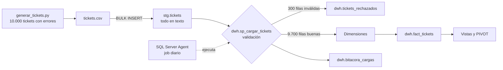
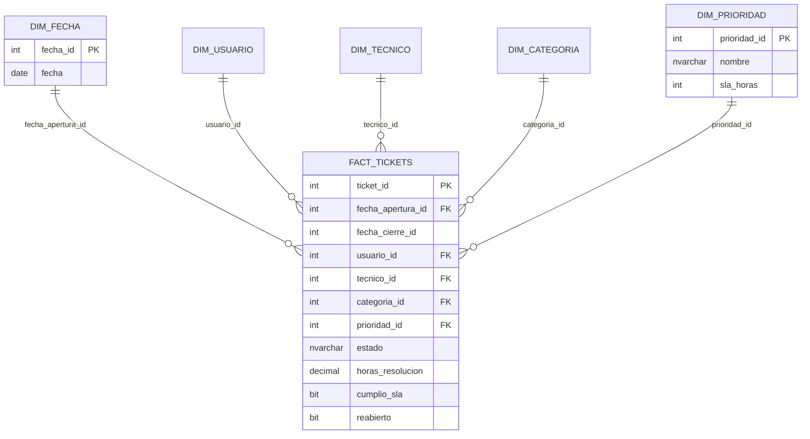
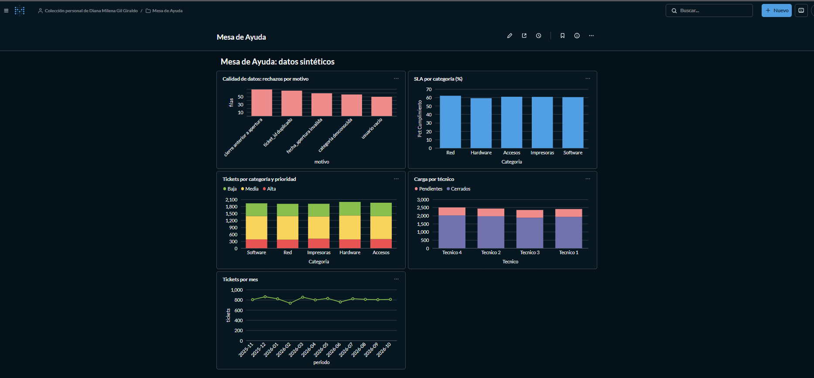
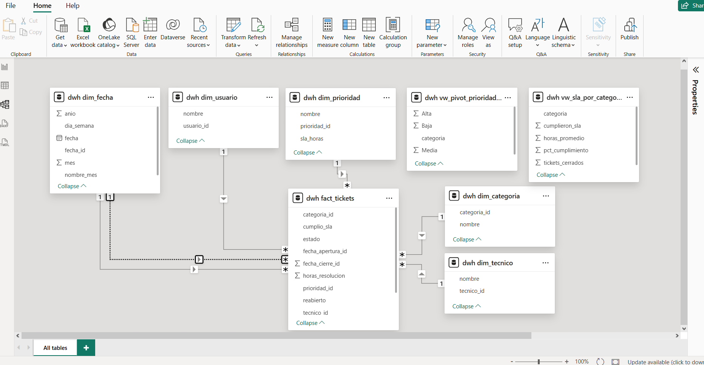
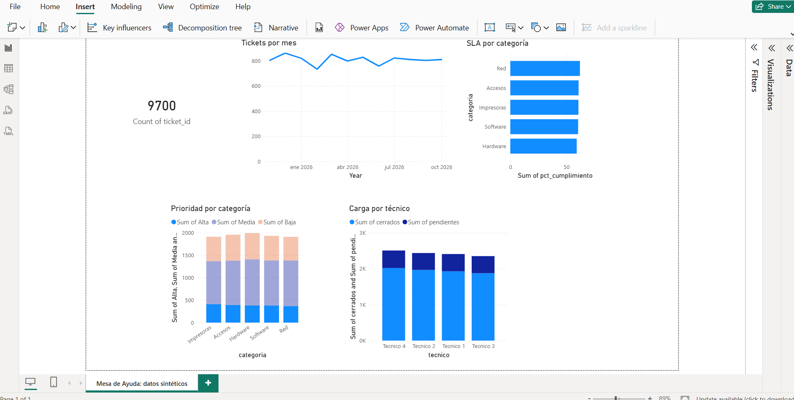

# Mesa de Ayuda: Data Warehouse en SQL Server

Proyecto de portafolio: un proceso ETL completo en **T-SQL** que carga tickets de una mesa de ayuda de TI, valida su calidad, los modela en un **esquema en estrella** y deja reportes listos para analizar. Corre sobre SQL Server 2022 en Docker.

> Los datos son **sintéticos** (generados con Python). Los resultados demuestran que el modelo funciona; no son conclusiones sobre una mesa de ayuda real.

## Qué demuestra este proyecto

- ETL en T-SQL: staging, validación, carga de dimensiones y hechos
- Procedimiento almacenado con transacción, `TRY/CATCH` y bitácora de cargas
- Calidad de datos: 300 de 10.000 registros rechazados, clasificados por motivo
- Carga **idempotente**: se puede repetir sin duplicar datos
- Modelo dimensional (hechos + 5 dimensiones)
- Vistas de reportes y `PIVOT`
- Índices con mejora medida
- Automatización con SQL Server Agent
- Docker, Python y Git
- Dashboards interactivos en Metabase y Power BI conectados directamente al Data Warehouse.

## Flujo de datos



## Modelo en estrella



**Granularidad:** una fila por ticket. **SLA:** Alta 4 h, Media 24 h, Baja 72 h.

## Calidad de datos

El procedimiento evalúa cada fila y la primera regla que falla da el motivo del rechazo:

| Motivo | Ejemplo |
|---|---|
| `ticket_id duplicado` | mismo id repetido |
| `fecha_apertura invalida` | `31/02/2026` |
| `cierre anterior a apertura` | cierre antes de la apertura |
| `categoria desconocida` | `Hardware/software` |
| `usuario vacio` | usuario en blanco |

Resultado de una carga: **10.000 leídas, 9.700 cargadas, 300 rechazadas.** Cada ejecución queda registrada en `dwh.bitacora_cargas`.

## Rendimiento

Un índice no agrupado sobre `(fecha_apertura_id, categoria_id)` en `fact_tickets` redujo las lecturas lógicas de **83 a 5 (-94%)** en una consulta filtrada por rango de fechas y categoría, medido con `SET STATISTICS IO`. Con más filas, el beneficio crece.

## Dashboard

Dashboard en Metabase y Power BI conectado al data warehouse: cumplimiento de SLA por categoría, carga por técnico, tickets por prioridad y por mes, y calidad de datos (rechazos por motivo).

### Metabase


### Power BI (Modelo Estrella)


### Power BI (General)



## Cómo ejecutarlo

Requisitos: Docker, Python 3 y VS Code con la extensión *SQL Server (mssql)*.

```bash
# 1. SQL Server en Docker (cambia <TU_CLAVE>)
docker run -e "ACCEPT_EULA=Y" -e "MSSQL_SA_PASSWORD=<TU_CLAVE>" \
  -e "MSSQL_AGENT_ENABLED=true" -p 1433:1433 --name sqlserver \
  -v sqldata:/var/opt/mssql -d mcr.microsoft.com/mssql/server:2022-latest

# 2. Generar los datos
python data/generar_tickets.py

# 3. Copiar el CSV al contenedor
docker cp data/tickets.csv sqlserver:/var/opt/mssql/data/tickets.csv
```

Luego ejecuta los scripts de `sql/` en orden:

| Script | Qué hace |
|---|---|
| `01_crear_bd_y_esquemas.sql` | Base `MesaAyuda` y esquemas `stg`, `dwh` |
| `02_staging.sql` | Tabla de staging (todo en texto) |
| `03_cargar_staging.sql` | `BULK INSERT` del CSV |
| `04_verificar_staging.sql` | Verificaciones de staging |
| `05_modelo_estrella.sql` | Dimensiones, hechos, rechazos y bitácora |
| `06_sp_cargar_tickets.sql` | Procedimiento ETL |
| `07_probar_carga.sql` | Ejecuta y verifica la carga |
| `08_vistas.sql` | Vistas de SLA y técnicos, y `PIVOT` |
| `09_probar_vistas.sql` | Consulta las vistas |
| `10_indices.sql` | Índice sobre `fact_tickets` |
| `11_medir_indices.sql` | Medición antes y después |
| `12_job_carga_diaria.sql` | Job de SQL Server Agent |
| `13_probar_job.sql` | Ejecuta el job y verifica la bitácora |

## Problemas encontrados

- `BULK INSERT` en Linux no admite `CODEPAGE`: se retiró la opción.
- El CSV venía con fin de línea `\r\n`: se usó `ROWTERMINATOR = '0x0d0a'` para que no quedara un `\r` pegado en la última columna.
- `TRY_CONVERT(DATETIME2, '')` devuelve `1900-01-01` y no `NULL`: se trata el texto vacío con `NULLIF` antes de convertir.
- El contenedor trabaja en UTC, por lo que las horas de la bitácora y del job están 5 horas adelantadas respecto a Colombia.

## Autora

Diana Milena Gil Giraldo, Tecnóloga en Análisis y Desarrollo de Sistemas de Información (SENA) y estudiante de Ingeniería de Software (UNIMINUTO).